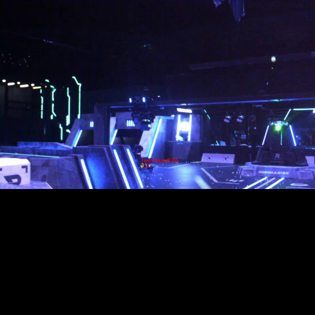
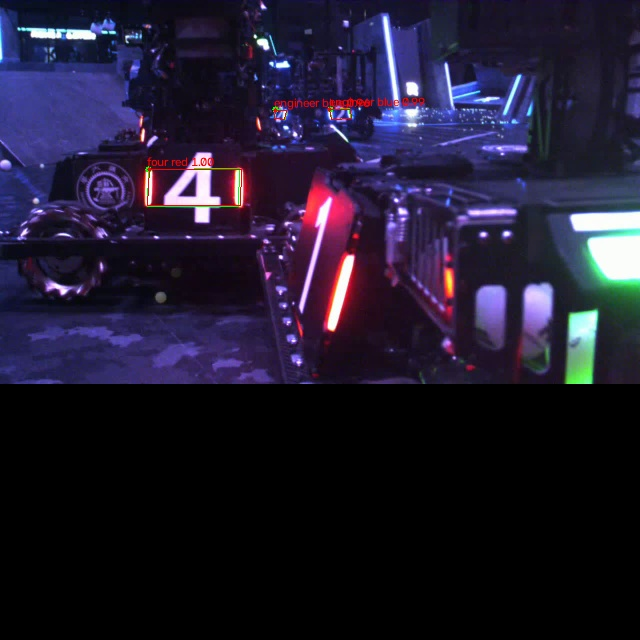
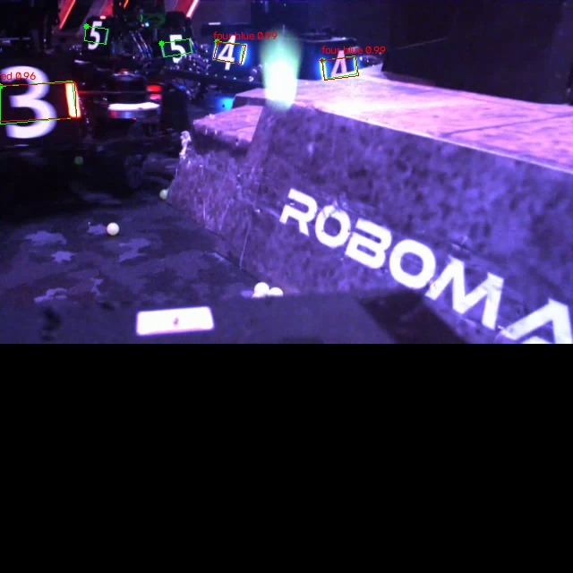

# Armor Training — YOLOv5s 四点装甲检测

流程：标注格式 → PyTorch 训练 → 验证 → ONNX → OpenVINO，输出直接接 27 自瞄仓库的 `yolov5.cpp`（`[1,25200,22]`）。

> 当前模型是 **GMaster2023 旧装甲板**上的 baseline，不是 2027 新装甲板的最终模型。新装甲板数据到位后从 `best.pt` 微调即可。

## 结果

同一个 test 集（clean200 人工核对的 40 张、77 个目标），按 27 的部署工作点（conf 0.7、NMS 0.3）：

| | 旧 kpt_large3（YOLOv5n） | 新 kpt_s（YOLOv5s） |
|---|---:|---:|
| 检测 F1 | 64.4% | **91.7%** |
| P / R | 68.1% / 61.0% | **90.0% / 93.5%** |
| 四点误差 median | 2.56 px | **0.76 px** |
| 类别 / 颜色 top1 | 90.4% / 94.2% | **100% / 100%** |
| box mAP50 | 0.351 | **0.825** |
| pose mAP50-95 | 0.334 | **0.804** |

补充：

- val 579 张（按场景划分，1251 个目标）：F1 **87.5%**，四点 median **1.21 px**，类别 **95.6%**，颜色 **98.9%**。
- test 40 张偏小，约 42% 与 train 有近重复帧；比较新旧模型时看差值，绝对值偏乐观。
- OpenVINO CPU 默认 bf16：新模型 val 只少 1 个 TP，test 完全一致；单张推理约 **12.3 ms**（旧 n 约 4.5 ms）。
- 完整指标：`results/metrics.json`、`results/metrics.csv`。

### 预测图





## 仓库结构

```text
├── setup_upstream.sh          # clone 官方 YOLOv5，切到固定 commit，再覆盖本仓库文件
├── requirements.txt
├── overrides/                 # 自己写的代码/配置，覆盖到官方 YOLOv5 上
│   ├── models/yolo.py         # DetectKpt 头（唯一修改的上游文件）
│   ├── models/yolov5s-kpt22.yaml
│   ├── data/hyps/hyp.kpt22.yaml
│   ├── utils/kpt/             # 关键点数据集/增强、分配/loss、指标
│   ├── train_kpt.py
│   ├── val_kpt.py
│   └── export_kpt_onnx.py
├── results/                   # 指标 + 5 张预测图
└── LICENSE                    # AGPL-3.0（YOLOv5 派生）
```


## 快速开始

```bash
# 1. 拉官方 YOLOv5 并覆盖本仓库代码
./setup_upstream.sh

# 2. 安装依赖（含 onnx / onnxruntime / openvino）
pip install -r requirements.txt

# 3. 下载预训练 backbone/neck
cd upstream
curl -L -o yolov5s.pt \
  https://github.com/ultralytics/yolov5/releases/download/v7.0/yolov5s.pt

# 4. 准备数据（见下一节），确保 datasets/data.yaml 存在
python train_kpt.py \
  --model yolov5s --weights yolov5s.pt \
  --data datasets/data.yaml \
  --epochs 200 --batch 8 --cache --name kpt_s

# 5. 验证 / 导出
python val_kpt.py --weights runs/kpt_s/best.pt --data datasets/data.yaml --split val
python export_kpt_onnx.py --weights runs/kpt_s/best.pt --out runs/kpt_s/kpt_s.onnx
```

`--cache` 约占用 5 GB 内存（large_split）。8 GB 显存下 batch 8 可用；OOM 就降 batch。

## 数据格式

训练标签每行：

```text
class color x1 y1 x2 y2 x3 y3 x4 y4 [flag]
```

- 坐标归一化到 `[0,1]`，点序 **TL→BL→BR→TR**。
- `class` 0..NC-1；当前 9 类：0 哨兵、1 英雄、2 工程、3/4/5 步兵、6 前哨站、7 基地、8 not_armor。
- `color`：0 蓝、1 红、2 熄灭、3 紫。
- `flag=1` 表示点序未核实（旧数据自动补回）；训练时用 8 种点序中最接近预测的那种算 loss，评估时不参与 Pose 指标。
- 不做水平/垂直翻转：镜像后的数字不是合法装甲。

期望的数据目录（`data.yaml` 里写绝对路径或相对 `path` 均可）：

```text
datasets/
├── data.yaml
├── labels/
│   ├── 0001.txt
│   └── ...
└── images/
    ├── 0001.jpg
    └── ...
```

`data.yaml` 至少包含：

```yaml
path: /absolute/path/to/datasets
train: train.txt
val: val.txt
test: test.txt
nc: 9
names: [sentry, hero, engineer, three, four, five, outpost, base, not_armor]
```

LabelMaster 的 10 值格式（`x1 y1 ... x4 y4 tag_id color_id`）需要先转成上面的训练格式；转换脚本属于内部数据准备流程，不在本仓库。

## 相对官方 YOLOv5 改了什么

- **检测头**：`models/yolo.py` 新增 `DetectKpt`，每个 anchor 输出 `8 点 + obj + 4 颜色 + NC 类别`（当前 22 维）。
- **图内解码**：`kpt_decode: true`，点 = `(格子 + 0.5) × stride + raw × anchor`，导出仍是 640 像素绝对坐标，27 parser 不用改。
- **anchors**：在装甲框上 k-means，替代 COCO anchors。
- **数据**：`utils/kpt/dataloaders.py` 四点数据集；mosaic/旋转/透视/运动模糊，关键点精确同步；27 同款左上黑边 letterbox；不翻转。
- **分配/loss**：`utils/kpt/loss.py`，每 GT 最多 10 个正样本，按 OKS 质量挑；质量感知 obj + 四点 L1 + OKS + 框 CIoU + 颜色/类别 CE + 几何约束。
- **验证**：`utils/kpt/metrics.py`，27 同款预处理/NMS；box mAP、Pose mAP、P/R/F1、类别/颜色、四点误差。
- **训练**：`train_kpt.py`，SGD、warmup、cosine、AMP、EMA、早停、断点续训。
- **导出**：`export_kpt_onnx.py`，ONNX opset 13，输出断言 `[1,25200,13+NC]`。

## 27赛季自瞄仓库部署约定

- 输入：`1×3×640×640`，27 用 OpenVINO PrePostProcessor 把 u8 BGR 转 f32 RGB/255。
- 输出：`[1,25200,22]`（NC=9）；通道 `0..7` 四点、`8` obj、`9..12` 颜色、`13..21` 类别。
- 预处理：最长边缩到 640，贴左上角，黑边；与训练/验证一致。
- 阈值：27 `yolov5.hpp` 硬编码 `score_threshold_ = 0.7`、`nms_threshold_ = 0.3`；配置里的 `min_confidence` 低于 0.7 不生效。
- 推理精度：保持 27 默认 bf16，不加 f32 hint。
- 部署时把导出的 `.xml/.bin` 放到 27 的 `assets/`，新建 config 指向它即可；不需要改 27 parser。

## 已知限制

- **旧数据、旧类别**：GMaster2023 是旧装甲；2027 新装甲/新类别要重新标数据再微调。
- **稀有类**：train 里 sentry、not_armor 为 0，base 2 个，熄灭色 4 个；模型基本认不出这些。
- **test 小**：40 张、77 个目标，且约 42% 与 train 有近重复帧；更可信的是 val 579 张。
- **域差异**：只在 GMaster 赛场视频帧上评估；仿真渲染、新相机、真机都未充分验证。
- **速度**：YOLOv5s 比旧 n 慢约 2.7 倍；CPU 延迟需按目标 hardware 实测。
- 没有做消融实验；上面“改了什么”是设计理由，不代表单项贡献。
